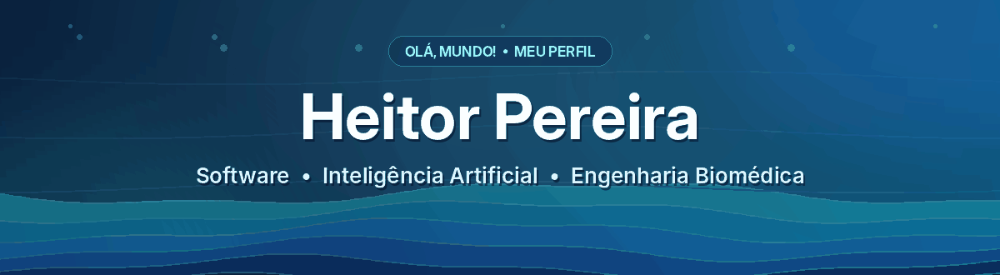

<h2>👋 Olá, mundo!</h2>

    <strong>Desenvolvedor de software</strong> com experiência em automação, integrações e inteligência artificial. 
    Graduando em <strong>Engenharia Biomédica na UFU</strong>, conectando tecnologia, dados e soluções para problemas reais.
  

  
<em>“Entre sinais, dados e código, gosto de transformar ideias em soluções úteis.”</em>

---
<h2 align="center">✨ Um pouco sobre mim</h2>
<table>
  <tr>
    <td width="50%" valign="top">
      <h3>🎯 O que eu faço?</h3>
      <ul>
        <li>💻 Desenvolvimento de software e integração de sistemas.</li>
        <li>⚙️ Automação de processos, APIs e resolução de problemas.</li>
        <li>🧠 Projetos com inteligência artificial, RAG e machine learning.</li>
        <li>📱 Desenvolvimento mobile com Flutter e Dart.</li>
        <li>🔬 Pesquisa aplicada a sinais biomédicos e sensores.</li>
      </ul>
    </td>
    <td width="50%" valign="top">
      <h3>⚡ Algumas curiosidades</h3>
      <ul>
        <li>🎓 Engenharia Biomédica na Universidade Federal de Uberlândia.</li>
        <li>🇮🇹 Período acadêmico na Scuola Superiore Sant’Anna, em Pisa.</li>
        <li>🎮 Games são um dos meus hobbies favoritos.</li>
        <li>🏋️ Gosto de treinar e acompanhar minha evolução.</li>
        <li>🚀 Tenho interesse em unir software, IA e saúde.</li>
      </ul>
    </td>
  </tr>
</table>
<h2 align="center">🛠️ Meu stack tecnológico</h2>
<table align="center">
  <tr>
    <td align="center" valign="top" width="25%">
      <h3>💻 Linguagens</h3>
       
       
       
      
    </td>
    <td align="center" valign="top" width="25%">
      <h3>🧠 Dados & IA</h3>
       
       
       
      
    </td>
    <td align="center" valign="top" width="25%">
      <h3>📱 Mobile</h3>
       
       
      
    </td>
    <td align="center" valign="top" width="25%">
      <h3>☁️ Ferramentas</h3>
       
       
       
      
    </td>
  </tr>
</table>
---
<h2 align="center">🚀 Projetos em destaque</h2>
<table>
  <tr>
    <td width="50%" valign="top">
      <h3>🦾 Intenção de movimento com EMG + IA</h3>
      
Projeto de TCC que combina sinais de eletromiografia, sensores inerciais e aprendizado de máquina para identificar intenções de movimento do braço.

      
      
      
    </td>
    <td width="50%" valign="top">
      <h3>📱 Aplicação mobile com Flutter</h3>
      
Desenvolvimento de uma aplicação voltada a serviços e formulários municipais, com fluxos de cadastro, validações e estudo de integração com Firebase.

      
      
      
    </td>
  </tr>
  <tr>
    <td width="50%" valign="top">
      <h3>🤖 Soluções de IA com RAG</h3>
      
Experiência construindo pipelines que conectam modelos de linguagem, busca semântica e informações recuperadas de bases vetoriais.

      
      
    </td>
    <td width="50%" valign="top">
      <h3>⚙️ Automações e integrações</h3>
      
Construção e manutenção de processos empresariais com JavaScript, APIs, tratamento de erros, logging e testes funcionais.

      
      
    </td>
  </tr>
</table>
---
<h2 align="center">🎮 Vida além do código</h2>

  
  
  
  

 

  <strong>Vamos construir algo interessante?</strong> 
  <a href="https://www.linkedin.com/in/heitorpnfc/">Conecte-se comigo no LinkedIn</a> · <a href="https://github.com/heitorpnfc">Explore meus repositórios</a>
    
  💠 README feito para o perfil <a href="https://github.com/heitorpnfc">@heitorpnfc</a>

